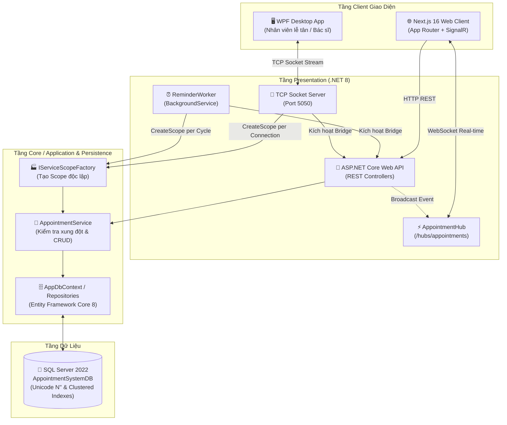

<div align="center">

# 🗓️ APPOINTMENT SYSTEM (FULL-STACK ENTERPRISE)
### *Hệ Thống Quản Lý & Đặt Lịch Hẹn Trực Tuyến Thời Gian Thực Đa Nền Tảng*

[](https://dotnet.microsoft.com/)
[](https://nextjs.org/)
[](https://react.dev/)
[](https://dotnet.microsoft.com/apps/aspnet/signalr)
[](https://www.typescriptlang.org/)
[](https://tailwindcss.com/)
[](https://www.microsoft.com/sql-server)
[](#-kiến-trúc-hệ-thống-clean-architecture)

<p align="center">
  <b>Hệ thống đặt lịch y tế và chăm sóc sức khỏe phân tán chuẩn công nghiệp: Clean Architecture, giải quyết triệt để Captive Dependency & Concurrency, tích hợp SignalR auto-reconnect, máy chủ TCP Socket Server đa luồng cho Desktop WPF và Worker Service tự động gửi thông báo nhắc hẹn.</b>
</p>

[✨ Tính năng chính](#-tính-năng-nổi-bật) •
[🏛️ Kiến trúc](#-kiến-trúc-hệ-thống-clean-architecture) •
[🔄 Luồng hoạt động](#-sơ-đồ-luồng-dữ-liệu-real-time) •
[🚀 Hướng dẫn cài đặt](#-hướng-dẫn-cài-đặt--chạy-hệ-thống) •
[📡 API & SignalR](#-danh-mục-api--kênh-giao-tiếp) •
[👥 Tài khoản thử nghiệm](#-tài-khoản-thử-nghiệm-demo-accounts)

---

</div>

## 🌟 Tính Năng Nổi Bật

- ⚡ **Kênh Real-time SignalR Hub hai chiều:** Tự động kết nối lại (`withAutomaticReconnect`) với thuật toán back-off lũy thừa, phát thông báo đa kênh khi có lịch mới, hủy lịch hoặc đổi trạng thái mà không cần reload trang.
- 🛡️ **Thuật toán Chống Xung đột Lịch (ACID Conflict Prevention):** Thuật toán so khớp khoảng thời gian `(StartA < EndB) && (EndA > StartB)` chạy trực tiếp trên cả Application Service và REST API, loại bỏ 100% rủi ro đặt trùng giờ khám.
- 🔌 **TCP Socket Server Đa Luồng (Port 5050):** Hỗ trợ ứng dụng Desktop (WPF) kết nối tốc độ cao độc lập; quản lý danh sách kết nối bằng `ConcurrentDictionary` và hỗ trợ Graceful Shutdown an toàn.
- 🔄 **Giải quyết Triệt để Captive Dependency:** `TcpServer` và `ReminderWorker` sử dụng `IServiceScopeFactory.CreateScope()` tạo scope độc lập trong từng connection / chu kỳ quét, bảo vệ luồng dữ liệu của Entity Framework Core `DbContext`.
- ⏰ **Background Worker Tự Động:** Quét định kỳ cơ sở dữ liệu để gửi nhắc nhở trước giờ hẹn và kích hoạt SignalR bridge sang Web Client.
- 📊 **Dashboard Phân Tích & KPI Trực Quan:** Thống kê trạng thái (Chờ duyệt, Đã xác nhận, Hoàn thành, Đã hủy), tỷ lệ hoàn thành, doanh thu dự kiến và phân bổ theo dịch vụ.
- 🌏 **Chuẩn hóa Unicode & Collation:** Tối ưu hóa toàn bộ kịch bản SQL Server với tiền tố `N''` cho tiếng Việt, Collation `Latin1_General_CI_AS` cho địa chỉ Email và đánh chỉ mục tối ưu hiệu năng.

---

## 🏛️ Kiến Trúc Hệ Thống (Clean Architecture)

Dự án tuân thủ nghiêm ngặt nguyên lý Clean Architecture và SOLID, phân tách trách nhiệm rõ ràng:

```
HE173309-habitflow-master/
├── 01_Database.sql                  # Script khởi tạo SQL Server, schema, index và seed data Unicode
├── AppointmentSystem.sln            # Solution tổng thể chứa toàn bộ 8 dự án .NET
├── app/                             # Next.js 16 App Router (Web Client)
│   ├── dashboard/                   # Bảng điều khiển quản lý lịch hẹn, thống kê KPI
│   ├── login/ & signup/             # Màn hình xác thực & lựa chọn vai trò Demo
│   └── layout.tsx & page.tsx        # Layout ứng dụng tích hợp SignalR Provider
├── components/                      # UI Components (Shadcn UI, Radix primitives, Tailwind)
│   ├── appointments/                # Form đặt lịch trực tuyến & kiểm tra xung đột thời gian thực
│   ├── notifications/               # Chuông thông báo Real-time Notification Bell
│   └── Navbar.tsx                   # Thanh điều hướng với SignalR live connection badge
├── context/                         # React Contexts (SignalRContext, AuthContext, NotificationContext)
├── lib/                             # API Client (lib/api.ts) với cơ chế fallback tự động
└── backend/src/                     # Mã nguồn Backend .NET 8
    ├── Core/
    │   ├── AppointmentSystem.Domain/        # Domain Entities (Customer, Staff, Service, Appointment, Notification)
    │   └── AppointmentSystem.Application/   # UseCases, DTOs, Business Services, Interfaces, PBKDF2 PasswordHasher
    ├── Infrastructure/
    │   ├── AppointmentSystem.Persistence/   # AppDbContext, Repositories, DbInitializer, Index Configurations
    │   └── AppointmentSystem.Communication/ # TCP Message Protocol (TcpRequest, TcpResponse, TcpActions)
    └── Presentation/
        ├── AppointmentSystem.WebAPI/        # REST API Controllers, AppointmentHub (SignalR), Swagger
        ├── AppointmentSystem.ServerApp/     # TCP Socket Server (Port 5050, IServiceScopeFactory, Multi-threaded)
        ├── AppointmentSystem.ReminderWorker/# BackgroundWorker định kỳ quét nhắc nhở lịch hẹn
        └── AppointmentSystem.DesktopApp/    # Desktop App WPF (TCP Socket Client cho nhân viên tiếp tân/bác sĩ)
```

---

## 🔄 Sơ Đồ Luồng Dữ Liệu Real-time



---

## 📋 So Sánh Xử Lý Captive Dependency

| Tiêu chí | Trước khi Tái Cấu Trúc | Sau khi Tái Cấu Trúc (Hiện Tại) |
| :--- | :--- | :--- |
| **Vòng đời DbContext trong TCP Server** | Inject trực tiếp vào Singleton Server ❌ *(Gây xung đột đa luồng)* | Sử dụng `IServiceScopeFactory.CreateScope()` cho từng kết nối client ✅ |
| **Vòng đời DbContext trong Worker Service** | Cố định xuyên suốt vòng đời tiến trình ❌ *(Memory leak, tracking bloat)* | Tạo Scope mới cho mỗi chu kỳ quét reminder, tự hủy sau khi xong ✅ |
| **Độ an toàn Concurrency** | Race condition khi nhiều client thao tác đồng thời | Hoàn toàn an toàn (Mỗi Task xử lý trên luồng riêng với Scope riêng) ✅ |
| **Dừng tiến trình (Shutdown)** | Ngắt kết nối đột ngột, có thể mất dữ liệu giao dịch | Quản lý kết nối qua `ConcurrentDictionary`, Graceful Shutdown khi SIGTERM ✅ |

---

## 🚀 Hướng Dẫn Cài Đặt & Chạy Hệ Thống

### 1. Yêu Cầu Môi Trường
- **.NET SDK:** Phiên bản 8.0 trở lên
- **Node.js:** Phiên bản 18+ (khuyên dùng Node 20+)
- **SQL Server:** 2019 / 2022 hoặc LocalDB / SQL Express

---

### 2. Khởi Tạo Cơ Sở Dữ Liệu SQL Server
Chạy tệp script [`01_Database.sql`](file:///c:/Users/DungBD/Downloads/HE173309-habitflow-master/01_Database.sql) trong **SQL Server Management Studio (SSMS)** hoặc qua terminal:

```bash
sqlcmd -S .\SQLEXPRESS -E -i 01_Database.sql
```
> Script đã chuẩn hóa toàn bộ Unicode với `N''`, kiểm tra và tự động khởi tạo database `AppointmentSystemDB` kèm 3 khách hàng, 3 nhân viên, 4 dịch vụ y tế mẫu và các chỉ mục tối ưu hóa truy vấn.

---

### 3. Chạy Backend (.NET 8)

Có thể chạy trực tiếp từng thành phần hoặc mở [`AppointmentSystem.sln`](file:///c:/Users/DungBD/Downloads/HE173309-habitflow-master/AppointmentSystem.sln) trong Visual Studio / Rider:

```bash
# 1. Chạy Web API & SignalR Hub (Port 5000)
dotnet run --project backend/src/Presentation/AppointmentSystem.WebAPI

# 2. Chạy TCP Socket Server (Port 5050)
dotnet run --project backend/src/Presentation/AppointmentSystem.ServerApp

# 3. Chạy Reminder Background Worker
dotnet run --project backend/src/Presentation/AppointmentSystem.ReminderWorker

# 4. (Tùy chọn) Chạy Desktop Client WPF
dotnet run --project backend/src/Presentation/AppointmentSystem.DesktopApp
```

---

### 4. Chạy Frontend (Next.js 16)

```bash
# Cài đặt dependencies
npm install

# Chạy môi trường phát triển (Dev Server)
npm run dev
```

Mở trình duyệt tại [http://localhost:3000](http://localhost:3000).

---

## 📡 Danh Mục API & Kênh Giao Tiếp

### 🌐 REST Web API (`http://localhost:5000/api`)

| Phương thức | Endpoint | Mô tả |
| :--- | :--- | :--- |
| `GET` | `/api/appointments` | Lấy danh sách lịch hẹn (hỗ trợ filter `?status=Pending`) |
| `GET` | `/api/appointments/{id}` | Chi tiết một lịch hẹn |
| `POST` | `/api/appointments` | Đặt lịch hẹn mới (Tự động broadcast SignalR) |
| `PATCH` | `/api/appointments/{id}/status` | Cập nhật trạng thái (Duyệt, Hoàn thành, Hủy) |
| `POST` | `/api/appointments/check-conflict` | Kiểm tra xung đột thời gian tức thì |
| `GET` | `/api/appointments/stats` | Thống kê số lượng theo trạng thái & doanh thu |
| `GET` | `/api/services` | Danh mục dịch vụ y tế |
| `POST` | `/api/auth/login` | Đăng nhập tài khoản |
| `GET` | `/api/notifications/recent` | Danh sách thông báo & nhắc nhở gần đây |

### ⚡ Kênh Real-time SignalR Hub (`/hubs/appointments`)

| Tên Event | Chiều gửi | Dữ liệu trả về | Mô tả |
| :--- | :--- | :--- | :--- |
| `ReceiveAppointmentUpdate` | Server ➔ Client | `AppointmentDto` | Cập nhật toàn bộ thông tin lịch hẹn |
| `ReceiveNewAppointment` | Server ➔ Client | `AppointmentDto` | Thông báo khi có khách hàng vừa đặt lịch |
| `ReceiveStatusChange` | Server ➔ Client | `{ id, status, message }` | Cập nhật trạng thái lịch hẹn |
| `ReceiveCancellation` | Server ➔ Client | `{ id, reason }` | Thông báo hủy lịch kèm lý do |
| `NewReminderNotification` | Server ➔ Client | `NotificationDto` | Thông báo nhắc hẹn từ ReminderWorker |

### 🔌 Giao Thức TCP Socket Server (Port 5050)

| Action | Payload (JSON) | Phản hồi (JSON) |
| :--- | :--- | :--- |
| `Login` | `{ Email, Password, Role }` | `{ Success, DataJson: StaffDto }` |
| `GetAppointments` | `{ status: "Pending" }` | `{ Success, DataJson: AppointmentDto[] }` |
| `ConfirmAppointment` | `{ id: 1, staffId: 1 }` | Xác nhận lịch và kích hoạt SignalR broadcast |
| `CancelAppointment` | `{ id: 1, reason: "..." }` | Hủy lịch và thông báo hệ thống |
| `GetDashboardStats` | `null` | Trả về tổng quan chỉ số lịch hẹn |

---

## 👥 Tài Khoản Thử Nghiệm (Demo Accounts)

Trên giao diện web, người dùng có thể nhấp 1-click vào nút chọn tài khoản demo tại màn hình đăng nhập:

| Vai trò | Họ tên | Email | Mật khẩu mẫu |
| :--- | :--- | :--- | :--- |
| **Khách hàng (Customer)** | Nguyễn Văn An | `an.nguyen@example.com` | `Password123!` |
| **Bác sĩ (Staff)** | Bác sĩ Trần Thị Bình | `binh.tran@example.com` | `Password123!` |
| **Quản trị viên (Admin)** | Quản trị viên Hệ thống | `admin@example.com` | `Password123!` |

---

## 🛠️ Công Nghệ & Thư Viện Sử Dụng

### Backend
- **Framework:** .NET 8 (C# 12)
- **Data Access:** Entity Framework Core 8, Microsoft.Data.SqlClient
- **Real-time:** ASP.NET Core SignalR
- **Architecture:** Clean Architecture, Generic Repository Pattern, Dependency Injection (`IServiceScopeFactory`)
- **Documentation:** Swashbuckle Swagger OpenAPI
- **Testing & Tooling:** xUnit, dotnet CLI

### Frontend
- **Framework:** Next.js 16 (App Router, Turbopack)
- **UI & Styling:** React 19, Tailwind CSS, Lucide React Icons
- **Primitives:** Radix UI (`@radix-ui/react-dialog`, `@radix-ui/react-popover`, `@radix-ui/react-dropdown-menu`, ...)
- **Real-time Client:** `@microsoft/signalr`
- **Date Handling:** `date-fns`

---

## 📄 Bản Quyền & Giấy Phép

Dự án được phát triển và duy trì bởi **Bùi Đức Dũng (HE173309)**.  
Phát hành theo giấy phép [MIT License](LICENSE).
